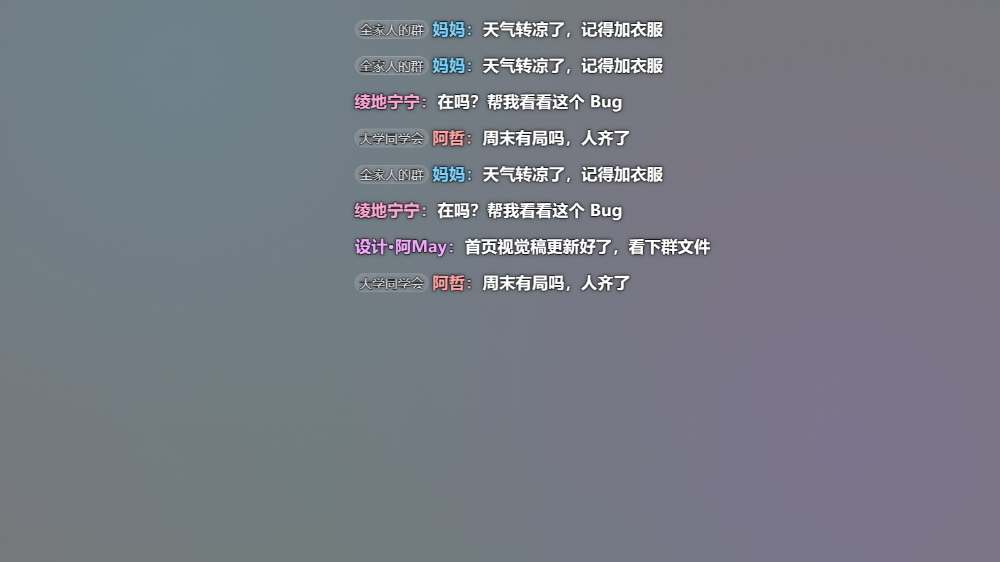
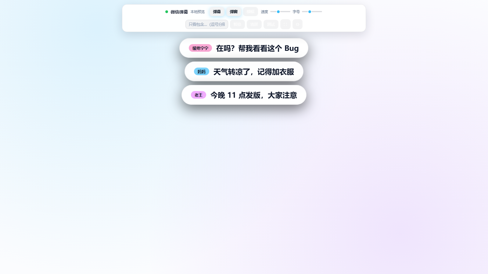
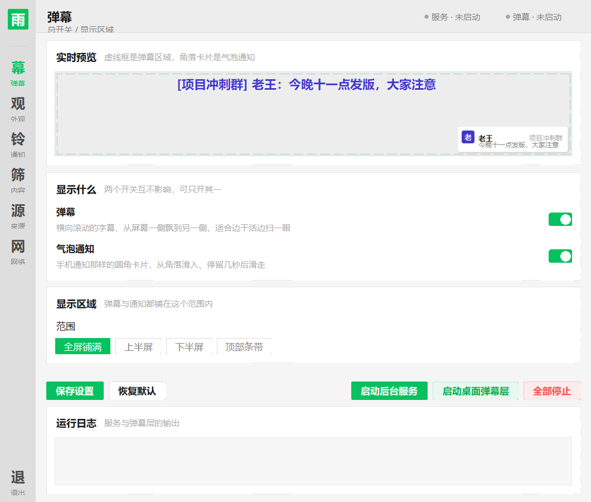
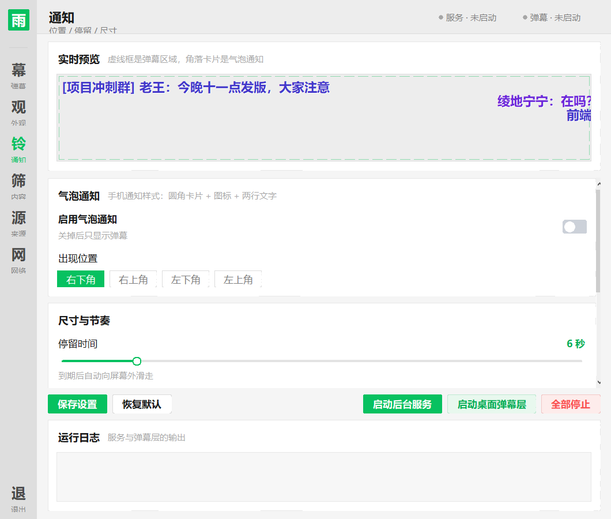
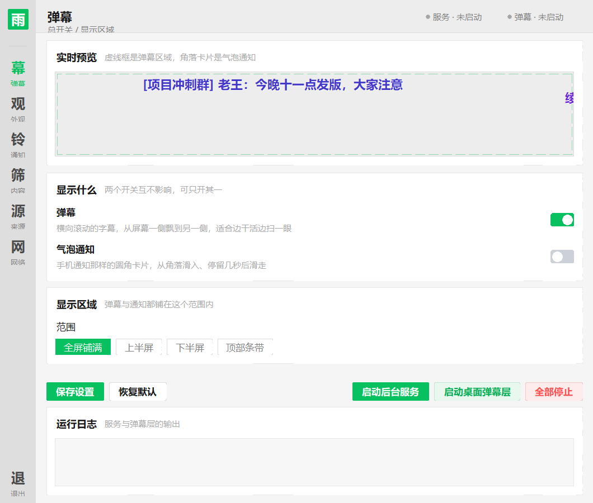

# 微信弹幕 · WeChat Danmaku

把消息变成屏幕上的 **弹幕**、**气泡通知**、**弹窗** 或 **顶部横幅**。

主打的是**桌面透明弹幕层**：全屏覆盖、背景完全透明、**鼠标直接穿透**——弹幕与通知
飘在桌面上，点击、拖拽、打字、快捷键一概不受影响，就像桌面上多了一层隐形的信息浮层。

| 桌面透明弹幕 | 气泡通知 | 顶部横幅 |
|---|---|---|
|  |  |  |

---

## 两种显示方式，各管各的开关

| 方式 | 长什么样 | 适合什么时候用 |
|---|---|---|
| **弹幕** | 文字从屏幕一侧横向飘到另一侧 | 边干活边扫一眼，不占位置 |
| **气泡通知** | 手机通知那样的圆角白卡，从屏幕角落滑入、停留几秒后滑走 | 想看清楚是谁发的、发了什么 |

两个开关**互相独立**：可以只开弹幕、只开通知，也可以一起开；两个都关就是纯静默。
消息内容的「关键词屏蔽」对两者同时生效。

气泡通知支持：出现位置（四角）、停留秒数、同屏堆叠上限、卡片宽度。

---

## 快速开始

### ① 打开设置面板（推荐从这里开始）

双击 **`设置面板.bat`**。

面板里调总开关、显示区域、速度、字号、不透明度、通知位置与停留时间，
还带一个**实时预览**——拖动滑块，上面的模拟效果立刻就变。

界面照着**微信 Windows 版浅色模式**做的：左侧一条浅灰窄栏切页（图标选中转微信绿），
右侧是顶栏 + 圆角分组卡片，主色 `#07c160`。




弹幕与气泡通知各有独立开关，四种组合都行；下图左边弹幕开着、右边通知关着：



| 底部按钮 | 作用 |
|---|---|
| 启动 / 停止后台服务 | 开始或停止接收消息 |
| 启动 / 停止桌面弹幕层 | 全屏透明弹幕上屏或收工 |
| 全部停止 | 一键收工，屏幕上不留任何东西 |
| 保存设置 | 立即写入 `settings.json`（其实拖动时就已经自动保存了） |

**改完立刻生效**：面板把设置写进 `settings.json`，正在运行的弹幕层会在一秒内读到变化并应用，
不用重启。

### ② 桌面透明弹幕（不用面板的话）

双击 **`start-overlay.bat`**。

字幕层会铺满整个屏幕，背景透明，鼠标可以照常点到下面的任何东西。

| 操作 | 说明 |
|---|---|
| `Ctrl+Alt+D` | 隐藏 / 显示弹幕（想安静看视频时用） |
| `Ctrl+Alt+Q` | 退出 |
| 控制台 `Ctrl+C` | 退出 |

启动脚本会自动把后台服务一并拉起来，不用手动开两个窗口。

### ③ 浏览器版

双击 **`start.bat`**，浏览器会打开展示页——也有弹幕、弹窗、横幅三种效果，
适合投屏、直播叠加（配合 OBS 窗口采集）。

### 只想先看看效果

没接微信消息源时，先把面板 **来源** 页的「演示数据」打开，服务就会持续播模拟消息，
弹幕层不会是空白的。想单独跑演示：双击 **`start-demo.bat`**。

### 想接真实微信消息

微信 4.1+ 需要先唤醒它的无障碍控件树，**不做这一步，任何库都连不上**：

```
① 双击 唤醒微信.bat            ← 微信每次重启后都要重做一次
② 面板「来源」页打开「监听微信消息」
③ 面板底部「启动后台服务」+「启动桌面弹幕层」
```

细节（原理、实测数据、两种监听模式）见下文 **接入真实微信消息**。

---

## 桌面弹幕层为什么「不影响用电脑」

这不是普通的置顶窗口，而是用 Windows 分层窗口扩展样式做的：

| 扩展样式 | 作用 |
|---|---|
| `WS_EX_TRANSPARENT` | **鼠标事件直接穿透**，点击落到桌面上，窗口形同虚设 |
| `WS_EX_LAYERED` | 分层窗口，配合颜色键实现**逐像素透明** |
| `WS_EX_NOACTIVATE` | 点击不激活窗口，**永不抢键盘焦点** |
| `WS_EX_TOOLWINDOW` | 不出现在任务栏和 `Alt+Tab` 列表里 |

再加上 `overrideredirect` 去掉边框、`SetWindowPos(HWND_TOPMOST)` 保持置顶。
全部走 Windows 原生 API，只依赖 Python 标准库（`tkinter` + `ctypes`）。

### 启动自检：宁可自己退出，也不占住你的屏幕

全屏 + 置顶 + 无边框 + 鼠标穿透，这几种属性叠在一起时，一旦某一步没生效，
就可能出现**一个全黑、又关不掉的窗口**，只能重启电脑。所以本程序启动时会
**向操作系统求证**三件事，而不是听自己的自述：

| 自检项 | 求证方式 | 拦下的失效 |
|---|---|---|
| 颜色键 | `GetLayeredWindowAttributes` 把颜色键读回来核对 | 系统没接受透明键 → 屏幕被近黑色铺满 |
| 鼠标穿透 | `WindowFromPoint` 看落点是否被本窗口接住 | 穿透没生效 → 点击被吞掉 |
| 屏幕遮挡 | 对比启动前后的屏幕像素，看是否有成片采样点变成同一块平色 | 画布底色 ≠ 颜色键 → 不透明地铺在屏幕上 |

三项全部通过才进入正式运行。**任何一项不通过，会立刻 `withdraw` 收回窗口并退出**
（退出码 2），屏幕上不会留下任何东西，同时打印出是哪一项、为什么。

这套自检是实测验证过的：故意把窗口改成不透明后，它准确报告
「屏幕遮挡 失败 —— 变动 100%，同色占 100%」并立刻收回窗口。

---

## 设置项一览

面板里的项目分六页：

| 页面 | 管什么 |
|---|---|
| **弹幕与通知** | 两个总开关（弹幕 / 气泡通知）、显示区域 |
| **弹幕外观** | 弹幕速度、字号、文字不透明度、文字亮度、同屏密度、文字描边、鼠标穿透、自动置顶 |
| **气泡通知** | 启用开关、出现位置、停留时间、同屏上限、卡片宽度 |
| **内容与屏蔽** | 是否显示昵称 / 群名、关键词屏蔽、浏览器页的弹窗停留与提示音 |
| **消息源** | 演示数据、微信监听、外部推送说明 |
| **网络与推送** | 监听范围、端口、推送地址与手机转发配置 |

| 设置项 | 说明 |
|---|---|
| **弹幕** / **气泡通知** | 两个总开关，互不影响 |
| **显示区域** | 全屏铺满 / 上半屏 / 下半屏 / 顶部条带（条带高度可调）；气泡通知也落在同一区域里 |
| **弹幕速度** | 像素/秒，40 ~ 600 |
| **弹幕字号** | 12 ~ 52 |
| **文字不透明度** | 35% ~ 100%，调低后文字真正半透明 |
| **文字亮度** | 压暗文字让它更柔和，适合长时间开着 |
| **同屏密度** | 屏幕上同时最多显示几条，防止刷屏 |
| **出现位置** | 气泡通知落在哪个角：右下 / 右上 / 左下 / 左上 |
| **停留时间** | 气泡停留几秒后自动滑走，2 ~ 30 秒 |
| **同屏上限** | 最多堆几张贴在一起，超出时最旧的那张先退场 |
| **卡片宽度** | 气泡卡片宽度，220 ~ 520 px |
| **关键词屏蔽** | 命中的消息不上屏，弹幕与通知一起跳过 |

### 「不透明度」是真半透明，不是把字调暗

这一项要单独说明，因为它有点特别：Windows 的颜色键透明只能做到「整像素挖空」，
本来做不出半透明文字。但**颜色键和窗口整体 alpha 可以同时使用**——
颜色键像素依旧完全挖空，其余像素（也就是文字）按 alpha 与桌面混合。

本项目就是这么实现的，并且用真实屏幕采样验证过：

| 设定 alpha | 文字笔画的实际像素 | 结论 |
|---|---|---|
| 0（不启用） | `(255, 63, 24)` | 原色，完全不透明 |
| 110 / 255 ≈ 43% | `(255, 172, 155)` | 与桌面白色混合，确实半透明 |
| 200 / 255 ≈ 78% | `(255, 104, 74)` | 介于两者之间，符合预期 |

所以调低不透明度后，**桌面壁纸会透过文字显出来**，而不是文字变暗。

### 气泡通知是怎么画出来的

气泡和弹幕共用同一个透明窗口，没有另开窗口——因为颜色键只挖掉「背景色」，
白底卡片、圆角、阴影都不受影响，照样能浮在桌面上。

一张卡片由这些画布元素拼成：阴影圆角块 → 白色圆角底板 → 彩色小图标（首字）→
昵称 → 群名 → 正文。生命周期分三段：

```
滑入 in  →  停留 hold（notify_life 秒）  →  滑走 out  →  销毁
```

几条补充规则：

- **堆叠**：最新的贴着角落，旧的依次让开；位置变化是平滑过渡的，不会「跳」一下。
- **上限**：超过 `notify_max` 时最旧的那张先退场，屏幕不会堆满。
- **退场方向**固定朝外——贴着右边就往右滑走，贴着左边就往左滑走。
- 卡片高度按正文实际折行结果算，长消息会自动变高，不会压字。

---

## 接入真实微信消息

> **结论先说：能接，本机已经跑通了。**
> 但微信 4.1+ 有一道「无障碍闸门」，得先打开，任何监听库才连得上。

### 为什么以前连不上——不是版本太新

微信 4.x 把界面换成了自绘渲染，**只在检测到无障碍客户端时才向系统暴露控件树**。
冷启动时那个状态位是 0，于是 `WM_GETOBJECT` 只能拿到一层 Qt 空壳：

```
主窗口 UIA 类名： Qt51514QWindowIcon      ← 空壳
子节点        ： MMUIRenderSubWindowHW   ← 再往下什么都没有
mmui:: 控件   ： 0 个
```

而 `wxauto4` 要求窗口在 UI Automation 里的类名是 `mmui::MainWindow`，
校验必然失败 → 报「未找到已登录的客户端主窗口」。

**所以降级微信不是唯一解，也不是最优解**——把那个状态位打开就行。

### 第一步：唤醒微信（必做，微信每次重启后都要重做一次）

双击项目根目录的 **`唤醒微信.bat`**，或在设置面板 **来源** 页点 **「唤醒微信」**。

它做的事：

1. 临时置系统「存在屏幕阅读器」标志（读屏软件本来就会做的事）；
2. 向微信进程写入 **1 个状态字节**——就是 Qt 自己也会写的那个位；
3. 立刻用「控件树是否真的出现」来校验，**没生效会自动回滚**；
4. **激活成功后自动把系统读屏标志收回**，并重新校验控件树：树还在就保持收回，树消失才放回去。

不注入代码、不重启微信、不改微信文件，写完当场生效。

> **为什么要自动收回（第 4 步）**：「存在屏幕阅读器」是**全局系统状态**，长期开着会让
> 所有应用都以为你在用读屏器，可能引起界面异常。本项目实测踩过一次坑：标志留在开启状态时，
> **鼠标指针持续闪烁、几乎无法操作**。实测证明这个标志只在「触发控件树物化」的那一刻有用——
> 关掉之后 `mmui::MainWindow` 依然健在，所以没有任何理由把它留在系统里。
> 万一某台机器上确实依赖它，脚本会自己发现（关掉后树没了）并放回去，不会导致功能失效。

> ⚠ **微信重启后那个字节会回到 0**，需要重新唤醒一次。这是它唯一的使用成本。

**实测记录（微信 4.1.15.51）**

| 项目 | 唤醒前 | 唤醒后 | 关掉读屏标志后 |
|---|---|---|---|
| 主窗口 UIA 类名 | `Qt51514QWindowIcon` | **`mmui::MainWindow`** | **`mmui::MainWindow`**（不变） |
| `mmui::` 控件 | 0 个 | 已物化 | 已物化（不变） |
| `wxauto4` 连接 | 失败 | **成功**，能读到昵称与会话列表 | 成功 |
| 实际读取 | — | **18 秒抓到活跃群聊里 21 条真实消息** | 正常 |

已收录的闸门地址（`Weixin.dll` 相对偏移 RVA）：

| 微信版本 | RVA |
|---|---|
| 4.1.11.22 | `0xA1E7DB8` |
| 4.1.13.65 | `0xAE2B0C8` |
| **4.1.15.51** | **`0xB36F9D8`** |

表里没有的版本会自动扫描 DLL 特征码，命中候选后逐个试写并校验，试错项自动回滚。
激活状态可用 `python tools/wechat_uia_wake.py status` 随时复查。

### 第二步：选监听方式

装 `wxauto4`（`pip install wxauto4`），然后在设置面板 **来源** 页打开
**「监听微信消息」**。免费版给的是**回调式**接口，项目里有两种用法：

| 模式 | 怎么配 | 行为 | 代价 |
|---|---|---|---|
| **读取当前窗口**（默认） | `watch_chats` 留空 | 读你当前打开的那个会话，切到哪个看哪个 | 无 |
| **事件监听** | `watch_chats` 填群名，如 `["26届新生群"]` | 后台单独盯这几个会话，窗口切走也不影响 | 微信会为每个会话**多开一个窗口** |

两种都默认**不显示自己发的消息**；想显示就把该来源的 `include_self` 设为 `true`。

> 启动时会先把当前窗口里已有的消息记为「已见」，所以不会一启动就把历史消息全刷上屏；
> 切换会话时同样只记录、不输出，只显示之后的新消息。

### 第三条路：外部推送（与微信版本无关）

任何能发 HTTP 请求的程序都能把消息投到弹幕上：

```bash
curl -X POST http://127.0.0.1:8765/api/push ^
  -H "Content-Type: application/json" ^
  -d "{\"chat\":\"项目群\",\"sender\":\"老王\",\"content\":\"上线了！\"}"
```

**让手机也能推送（三步）**

1. 打开 `设置面板.bat` → **网络与推送** → 把「允许访问的设备」改成
   **「局域网内的设备（手机可推送）」**，点保存
2. 点面板底部 **「启动后台服务」**（改过监听范围需要重启一次服务）
3. 面板上会显示推送地址，例如 `http://192.168.1.13:8765/`。
   手机连同一个 Wi-Fi，浏览器打开这个地址下的 `/api/status`，能看到 JSON 就说明通了

> 首次监听局域网时 Windows 可能弹出**防火墙提示**，务必选「允许访问」，
> 否则手机连不上。

手机上用一个自动化 App 监听通知并转发：

| 平台 | 工具 | 做法 |
|---|---|---|
| Android | MacroDroid / Tasker | 触发器选「收到微信通知」，动作选「HTTP POST」→ `http://192.168.1.13:8765/api/push`，请求体 `{"content":"通知内容","sender":"微信新消息"}` |
| iOS | — | **基本走不通**。iOS 不给第三方 App 读别的 App 的通知内容，快捷指令也拿不到，除非越狱。iPhone 用户请用上面的「唤醒微信」读电脑端窗口 |

其他脚本（AutoHotkey、Python、Node）、企业微信机器人，把内容转成上面这个
JSON 格式 POST 过来即可。

### 补充：Plus 版库

如果不想动微信内存，也可以用 `wxautox4`（作者的 Plus 版，需购买激活码），
它自带绕过手段：

```bash
.venv\Scripts\pip install wxautox4
.venv\Scripts\wxautox4 auth activate <你的激活码>
```

装好后本项目的探测逻辑会自动优先使用它，无需改代码。

### 只想先看效果

`start-demo.bat` 会持续播放模拟消息，用来预览排版、调参数、录屏演示都够用。

---

## 配置

### settings.json（推荐，设置面板写的就是它）

三处共用这一份配置：**设置面板**、**桌面弹幕层**、**后台服务**。
所以面板里改完之后，实际跑起来的东西一定和面板显示的一致。

改完**立刻生效**（弹幕层会在 1 秒内应用），不用重启。

| 字段 | 说明 |
|---|---|
| `server.host` | `127.0.0.1` = 只有本机能推送；`0.0.0.0` = 手机等局域网设备也能推 |
| `server.port` | 端口，默认 8765 |
| `sources.demo.enabled` | 是否播放模拟消息 |
| `sources.wxauto.enabled` | 是否尝试监听微信 |
| `sources.wxauto.watch_chats` | 要监听的会话；留空 = 读取当前打开的聊天窗口 |
| `display.danmaku_enabled` | 弹幕总开关 |
| `display.notify_enabled` | 气泡通知总开关 |
| `display.region` | `full` / `top` / `bottom` / `bar` |
| `display.anchor` | `top` / `bottom`（仅条带模式生效） |
| `display.bar_height` | 条带模式的高度 |
| `display.speed` | 弹幕速度（像素/秒） |
| `display.font` | 字号 |
| `display.opacity` | 文字不透明度 0.35 ~ 1.0 |
| `display.dim` | 文字亮度 0.3 ~ 1.0 |
| `display.density` | 同屏弹幕上限 |
| `display.shadow` | 是否画文字描边 |
| `display.click_through` | 鼠标穿透（**强烈建议保持 true**） |
| `display.keep_top` | 是否自动保持置顶 |
| `display.notify_pos` | 气泡位置：`br` 右下 / `tr` 右上 / `bl` 左下 / `tl` 左上 |
| `display.notify_life` | 气泡停留秒数 |
| `display.notify_max` | 同屏最多堆叠几个气泡 |
| `display.notify_width` | 气泡卡片宽度（像素） |
| `display.show_sender` / `show_chat` | 弹幕里是否显示昵称 / 群名 |
| `display.filters` | 屏蔽关键词数组，如 `["红包", "广告"]`，弹幕与通知一起跳过 |

### config.json（旧格式，仍然兼容）

只在 `settings.json` 不存在时才会读它。字段含义与上面 `server` / `sources` 段相同。

---

## 桌面弹幕层参数

**推荐用 `run_overlay.py` 启动**：它按 `settings.json` 生成参数，和面板、bat
走的是同一条路径，从根上避免「面板里改了、启动参数没跟上」这类对不上：

```bash
python run_overlay.py                # 按设置启动；服务没跑就顺手拉起
python run_overlay.py --no-service   # 不自动拉服务（设置面板自己管）
python run_overlay.py --font 40      # 额外参数原样透传给 overlay.py
```

也可以直接调 `desktop/overlay.py`（此时以命令行为准，便于单文件调试）：

```bash
python desktop/overlay.py --font 26 --speed 190 --opacity 0.7
```

| 参数 | 说明 |
|---|---|
| `--font` | 字号，默认 26 |
| `--speed` | 速度（像素/秒），默认 190 |
| `--opacity` | 文字不透明度 0.35~1.0，默认 1.0；调低后文字**真正半透明**，背景依旧完全透明 |
| `--dim` | 文字亮度 0.3~1.0，调低更柔和、更不干扰，默认 1.0 |
| `--max-items` | 同时在屏弹幕上限，默认 45 |
| `--region` | `full` 全屏 / `top` 上半屏 / `bottom` 下半屏 / `bar` 顶部条带 |
| `--anchor` | `top` / `bottom`，弹幕从屏幕上方还是下方铺开 |
| `--height` | 覆盖高度，默认铺满整屏 |
| `--ratio` | 按屏幕高度比例取范围，`0.5` = 半屏（与 `--height` 同时给出时以 `--height` 为准） |
| `--filters` | 屏蔽关键词，逗号分隔，命中的消息不上屏 |
| `--no-sender` / `--no-chat` | 弹幕里不显示昵称 / 群名 |
| `--no-danmaku` | 关掉弹幕，只留气泡通知 |
| `--no-notify` | 关掉气泡通知，只留弹幕 |
| `--notify-pos` | 气泡位置：`br` 右下（默认）/ `tr` 右上 / `bl` 左下 / `tl` 左上 |
| `--notify-life` | 气泡停留秒数，默认 6 |
| `--notify-max` | 同屏最多堆叠几个气泡，默认 4 |
| `--notify-width` | 气泡卡片宽度（像素），默认 320 |
| `--settings 路径` | 指定 settings.json；给出后**面板改完会立刻生效**，无需重启 |
| `--geometry` | 手动指定范围，如 `1920x400+0+0`（多显示器时可用） |
| `--band` | 改用半透明黑条背景（不透明但更清晰） |
| `--alpha` | 黑条模式的不透明度 |
| `--frame-ms` | 刷新间隔，默认 28 毫秒 |
| `--no-shadow` | 不画文字描边 |
| `--no-click-through` | 关掉鼠标穿透（这时窗口会接收鼠标事件） |
| `--no-keep-top` | 不自动保持置顶 |
| `--no-hotkey` | 不注册全局热键 |
| `--quiet` | 不显示启动提示文字 |
| `--auto-exit 秒` | N 秒后自动退出，默认 0（不自动退出）；适合无人值守的限时展示 |
| `--skip-check` | 跳过启动自检（**不建议**，等于拆掉防黑屏的最后一道闸） |

---

## 浏览器版的 URL 参数

| 参数 | 作用 | 示例 |
|---|---|---|
| `demo` | 自动播放 N 条示例消息 | `/?demo=6` |
| `clean` | 隐藏控制条 | `/?clean=1` |
| `mode` | 指定展示方式 | `/?mode=danmaku,banner` |
| `bg` | 指定背景 | `/?bg=light` |
| `pos` | 弹窗位置 | `/?pos=tr` |
| `offset` | 弹幕从第 N 秒进度开始 | `/?offset=4` |
| `offline` | 不连服务，纯本地预览 | `/?offline=1` |

浏览器版快捷键：`空格` 暂停、`C` 清屏、`F` 全屏、`H` 隐藏控制条、`S` 设置面板。

---

## 目录结构

```
wechat-danmaku/
├── app.py                  服务主程序（HTTP + SSE，仅用标准库）
├── hub.py                  消息广播中心
├── settings.py             设置真源：读写 settings.json
├── settings.json           设置（面板 / 弹幕层 / 服务共用同一份）
├── run_overlay.py          按设置启动弹幕层，bat 与面板的公共入口
├── sources/
│   ├── wxauto_source.py    微信监听（自动探测 wxauto / wxauto4 / wxautox4）
│   └── demo_source.py      演示数据源
├── tools/
│   └── wechat_uia_wake.py  唤醒微信无障碍树（微信 4.1+ 必需）
├── web/                    浏览器展示页（弹幕 / 弹窗 / 横幅）
├── desktop/
│   ├── overlay.py          桌面透明弹幕层（弹幕 + 气泡通知，tkinter + ctypes）
│   └── settings_gui.py     图形化设置面板（浅色主题，六页）
├── config.json             旧格式配置（仅在 settings.json 不存在时读）
├── .venv/                  项目虚拟环境（微信监听库装在这里）
├── 唤醒微信.bat            唤醒微信无障碍树（微信每次重启后都要重做一次）
├── 设置面板.bat            图形化设置面板（推荐从这开始）
├── start-overlay.bat       启动桌面透明弹幕层
├── start.bat               启动后台服务
└── start-demo.bat          演示模式
```

---

## 工作原理

```
  手机转发 / 任意脚本               微信窗口
        │                             │
        ▼                    UI Automation
   POST /api/push                      │
        │                              ▼
        └──────────────▶ 消息源 ──▶ MessageHub ──SSE──┬──▶ 浏览器展示页
                                                      └──▶ 桌面透明弹幕层
                                                             ├─ 弹幕（横向滚动）
                                                             └─ 气泡通知（角落卡片）
                                                              ▲
                                        settings.json ────────┘
                                         （设置面板写入，热更新）
```

- **不注入、不 Hook、不破解**：UI Automation 只读取窗口上已渲染的文字，不碰进程内存和网络协议。
- **只读单向**：本工具只负责「显示」，不会替你发消息或自动回复。
- **服务零依赖**：`app.py` 只用 Python 标准库，不装任何包也能跑（只是接不到微信）。
- **实时推送**：SSE 长连接，消息到达即刻上屏。

---

## 常见问题

**Q：弹幕层启动了，但屏幕上什么都没有？**
没有消息源时默认播放演示消息，应该能看到。若确实空白，检查 `start-overlay.bat` 的
控制台里「鼠标穿透」是否显示「已开启」，以及是否误按了 `Ctrl+Alt+D`。

**Q：弹幕挡住鼠标点击了，点不到桌面？**
说明穿透样式没设置成功。控制台会明确提示「未开启」。可尝试以管理员身份运行；
若仍不行，多半是系统策略限制，可改用浏览器版。

**Q：想同时用桌面弹幕和浏览器展示？**
先 `start.bat`，再 `start-overlay.bat`（它会检测到服务已在运行，直接启动弹幕层），
然后在浏览器打开 `http://127.0.0.1:8765/`。多端会同时收到消息。

**Q：想只留气泡通知、不要弹幕（或反过来）？**
在面板第一页「弹幕与通知」里关掉对应那个开关即可，两个开关互不影响，改完一秒内生效。

**Q：气泡通知没出现？**
按顺序检查：① 面板第一页的「气泡通知」开关是否打开；② 气泡落在「显示区域」的范围里，
如果区域选了上半屏，气泡就出现在上半屏的角落，不会跑到屏幕底部；
③ 检查「同屏上限」是否被调到 1 且屏幕上已有一张。

**Q：在面板里改完设置，还要重启弹幕层吗？**
不用。面板把设置写进 `settings.json`，运行中的弹幕层每秒检查一次，发现变化就应用
（速度、字号、不透明度、亮度、密度、描边、屏蔽词、显示区域都能热更新）。
控制台会打印 `[overlay] 设置已更新：…` 供你确认。

**Q：手机推送收不到？**
按顺序检查：① 面板里「允许访问的设备」是否已改成局域网；② 改完**重启一次后台服务**；
③ 首次监听时 Windows 防火墙提示有没有点「允许访问」；④ 手机和电脑是否在同一个 Wi-Fi
（有些路由器开了「AP 隔离」会挡住）；⑤ 用手机浏览器打开 `http://电脑IP:端口/api/status`
看是否返回 JSON。

**Q：接不上微信？**
九成是**没唤醒无障碍树**——先双击 `唤醒微信.bat`（微信每次重启后都要重做一次）。
还不行就按顺序查：① 微信已登录、主窗口没最小化；② `pip install wxauto4` 装了没；
③ 微信若以管理员运行，本程序也要管理员权限；④ 跑
`python tools/wechat_uia_wake.py status` 看 `mmui` 是不是 `true`。
实在不想碰微信，就用上面的「外部推送」，与微信版本无关。

**Q：端口被占用？**
程序会自动往后找可用端口，以启动时打印的地址为准。

---

## 免责声明

本工具用于个人消息的可视化提醒。第三方自动化库与微信官方无任何隶属关系，
使用可能触发风控，请勿用于群发营销、骚扰等违反微信用户协议的行为。
